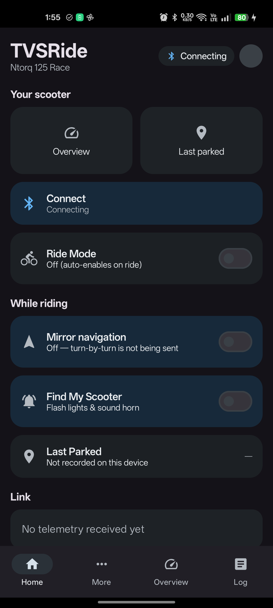
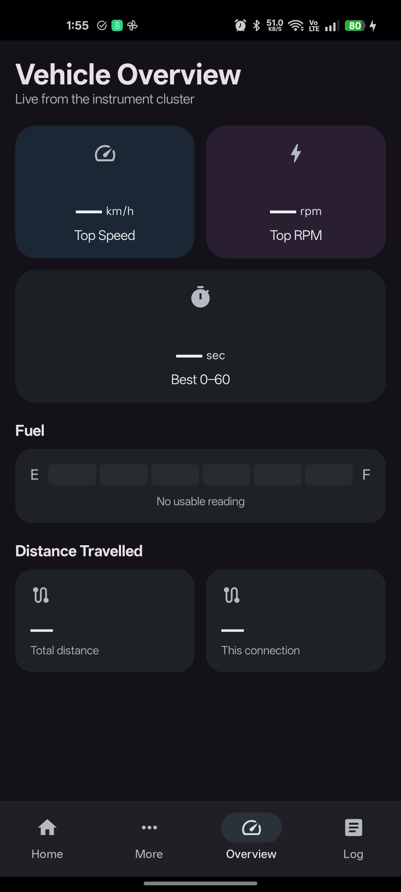
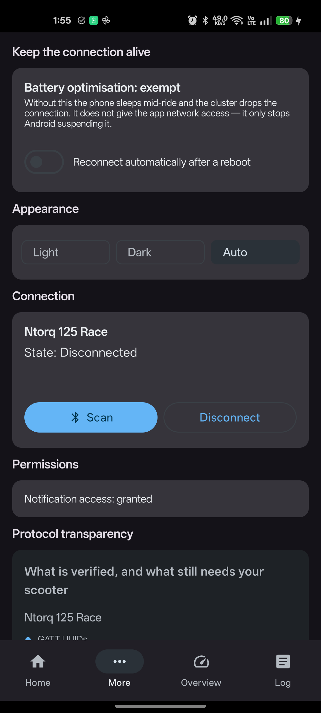
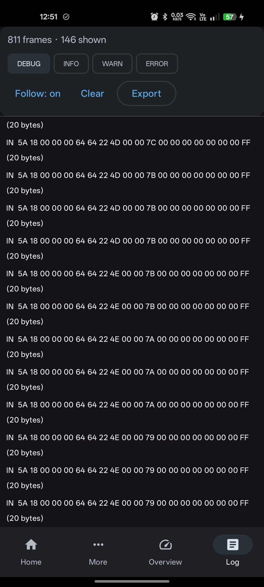

# TVSRide

A third-party companion app for **TVS SmartXonnect** vehicles — Ntorq, Jupiter,
Apache, Raider, iQube. Speaks the instrument cluster's Bluetooth LE protocol
directly and mirrors turn-by-turn navigation from **whatever maps app you
already use**, with **no TVS account, no TVS servers, and no telemetry upload**.

```
Google Maps / MapMyIndia / Organic Maps / Waze
        │  (notification, read-only)
        ▼
  NotificationListenerService  ──►  pictogram + text  ──►  BLE  ──►  cluster
```

`INTERNET` is declared only for embedded map tiles, place search and routing
(OpenStreetMap / user-supplied routing keys where configured). It is never used
to contact TVS or to upload data, and contact/call-log data stays on the device.

---

## Status

Current release: **v0.3.0** (versionCode 19, 2026-11-28) —
[tagged release](https://github.com/athulkrishna2015/TVSRideCompanion/releases/tag/v0.3.0).

| Area | State |
| :--- | :--- |
| Ntorq + Raider inbound | 8 frame layouts, **confirmed against a real cluster** |
| GATT / transport | **working on hardware** — GATT up in ~0.4 s, MTU 65, 20-byte frames |
| Discovery + connect | **connected to the rider's own Ntorq 125**; reconnects after a drop |
| AES-CTR handshake | built, and **the cluster never sends a challenge** — unused on this vehicle |
| Navigation HUD packets | **observed on the wire** — `0x5A 0x4E` and `0x5B 0x4F` reaching the cluster |
| Caller ID / SMS | packets wired; cluster supports it per the manual; **not yet seen live** |
| Text sanitiser | fixed on hardware — punctuation no longer becomes `X` |
| Cluster alpha-numeric rows | **layout still unconfirmed** — see the open questions below |
| UI | adapted Material 3, light/dark/auto, **running on device** |
| Tests | 175 JVM test methods over the protocol/nav layers, run in CI |
| APK analysis | complete for the protocol packages |

The handshake, GATT and navigation layouts are cross-checked against **two**
independent applications. Where they agree, a fact is solid; where they differ,
both are documented rather than silently merged.

### Screenshots

Captured from the running app. The cluster is currently out of service with a
flat battery, so these show the **disconnected** state — which is also the state
a new user sees first. No location, no street names, no device identifiers: the
cluster MAC is redacted wherever the UI shows it.

| Home | Overview |
| :--- | :--- |
|  |  |

| More | Frame log |
| :--- | :--- |
|  |  |

Overview is the interesting one when disconnected: every tile reads `—` and the
fuel gauge says **No usable reading**. Neither is a placeholder. A tile showing
`0` with no scooter connected would mean the UI was inventing data.

Home shows **Mirror navigation** already on, with nothing to switch. It is the
app's reason to exist, and the bridge does nothing until a maps app posts a
navigation notification — so enabling it costs nothing and asking twice is a
worse default. The toggle is still there for anyone who wants the cluster left
alone.

The Log tab is the project's evidence base: every frame in and out is hex-dumped
with a timestamp. **Export…** opens the system *Create Document* picker (SAF), so
the rider chooses where the redacted bundle goes. In the shot above the log is
12 lines for a full launch and two connect attempts. An earlier build logged a
dropped write every two seconds for as long as the link was down, which was 28%
of every log file — the same failure hiding in the evidence as in the display.

**Exports are redacted.** MAC addresses, navigation text, caller/message details,
rider name and parked coordinates are stripped before writing the bundle, so a
shared log or JSON export is not a route and a contact list. The on-device log
keeps the full detail for debugging; only exports are cleaned. The app-scoped
route still works for a phone you cannot root:

```bash
tools/capture-session.sh                 # restart, capture, pull the session log
adb exec-out run-as dev.tvsopen cat files/logs/tvsride.log > session.log
```

### Navigation sources and testing

Any maps app that posts a conventional turn-by-turn notification works.
**More → Extra maps apps**, **Extra message apps** and **Extra call apps** let
you add providers by package name; only add apps you trust to post navigation,
call or message notifications. Call/message classification is structural
(telecom extras, `MessagingStyle`), not a hard-coded package list. A reposted
call/message notification is deduplicated by the Android notification key, and
a 60 s watchdog clears the cluster HUD when no new navigation step arrives.
**Notification access: granted and receiving** in More reflects whether the
listener is actually bound, not just whether the Settings toggle is on. If the
system kills the listener, the app asks to be rebound so mirroring recovers
without a restart.

The cluster gets a two-line layout: the maneuver on the 10-character line 1 and
the place name / ETA rolling on the 12-character line 2. Spanish instructions
are recognised from the notification *content* (`gira a la izquierda`,
`Llegada: …`, `primera salida`) rather than from a UI locale switch. Roundabout
exits 1–7 map to the vendor's seven bearing pictograms, and road words are
abbreviated (`Road` → `Rd`, `Calle` → `Cll`) so street names fit; see
[docs/NAVIGATION.md](docs/NAVIGATION.md).

**More → TESTING → Keep screen on** is foreground-scoped: the screen stays awake
only while this app is in the foreground. It is off by default and is meant for
capture and debugging — it costs battery, so turn it off again afterwards.

## Download

- **Debug APK (every push/PR):** open the latest successful [Android Actions run](https://github.com/athulkrishna2015/TVSRideCompanion/actions/workflows/android.yml), download the **`app-debug`** artifact, and install `app-debug.apk` (`adb install -r app-debug.apk`). This is the debug-signed build used for development and `run-as` log access.
- **Tagged releases:** a `v*` tag (or a manual workflow dispatch) also attaches the same APK to a [GitHub Release](https://github.com/athulkrishna2015/TVSRideCompanion/releases). The current one is [v0.3.0](https://github.com/athulkrishna2015/TVSRideCompanion/releases/tag/v0.3.0).

### Tested on a phone — and connected to a scooter once

Those are two different claims and it is worth keeping them apart: the app has
been driven on a real phone many times, and the owner's own Ntorq 125 was
connected on 2026-10-13 (below). The cluster is currently out of service, so no
further hardware pass is possible.

CI runs `:app:testDebugUnitTest :app:assembleDebug` with two workers and asserts
the merged manifest's permission set: `INTERNET` **is present** for embedded
map tiles/search/routing, alongside the BLE and `POST_NOTIFICATIONS` permissions;
`ANSWER_PHONE_CALLS` and `CALL_PHONE` stay absent. The app has been installed
and driven on a real device many times — which is how the Overview/Log tab swap,
an unreachable Ride Mode toggle, and a log sink that discarded every session
were all found. None of them were visible to any test.

### Connected, and what that changed

A Bluetooth connection to the owner's own Ntorq 125 happened on 2026-10-13, and
it corrected more assumptions than it confirmed:

- **The cluster advertises no service UUID.** A scan filtered on the documented
  UUID finds nothing. It has to be found by name.
- **No pair mode and no bonding are needed**, and the cluster sends **no `9B F2`
  challenge** — the handshake is implemented and unused on this vehicle.
- **The transcribed frame table is partly wrong.** `0x16` arrives nearly as often
  as the speedometer and is not in it; `0x19` is listed and never arrives.
- **Multi-byte fields were read little-endian** while the cluster sends
  big-endian. The odometer read 278,733 km on a bike ridden 16,593 km.
- **Navigation mirroring had never sent a frame.** The bridge was handed a null
  instruction on every frame, and the UI strip read a different flow, so it
  *looked* end-to-end on the phone while having never once run over BLE.

Every one of those produced a screen that looked right. That is the argument for
reading the raw bytes rather than trusting the display.

Still unconfirmed: the cluster's own text placement/scrolling across the 10- and
12-character rows, and caller ID/SMS end to end. The rider-name packet ID is
now settled (`0x5B 0x52`, verified three ways); how the cluster renders the
17-byte payload is not.

### Defaults, and why each obvious-looking default is wrong

A first launch now works end to end without touching a switch:

- **Permissions are asked for up front**, in one sequence — Bluetooth,
  notifications, and the caller-ID set — plus a pointer to Notification access,
  which is a Settings toggle that no dialog in the app can grant. It matters
  because notification access is what turn-by-turn is *built on*: without it a
  rider could install, connect successfully, start a route and see nothing on the
  cluster, with nothing indicating why.
- **The last scooter reconnects on launch**, with no scanning. The stored MAC is
  the only thing that identifies a cluster, and this one advertises no service
  UUID — so a scan is both slower and less certain than reconnecting to the
  address already known.
- **Navigation mirroring is on** (above).
- **The scan does not filter on service UUID.** Measured, not preferred: a
  `ScanFilter.setServiceUuid` is applied to the advertisement packet, and this
  cluster advertises no UUID, so a filtered scan found *nothing* on the one
  vehicle known to work (hence the filter defaults off).
- **Ntorq is preselected** in the scan screen. The advertised name is `TVSBT…`
  with no model in it, so the name-based guess resolves to `UNKNOWN`, which
  selects a driver with no frame table, no navigation and no caller ID — a
  connection that looks successful while decoding nothing.
- **First run asks for the permission set up front.** Bluetooth and optional
  caller-ID permissions are requested together; notification access is a
  separate Settings toggle because Android does not grant it through a runtime
  permission dialog. Declining caller-ID access does not block BLE/navigation.
- **The scan filter and chosen model are remembered.** The default filter is
  off; a user's filter toggle and per-scooter model selection are persisted so
  reopening Scan does not silently reset either one.

### Rider name: editable, and sent to the cluster

TVS's manual documents the cluster greeting you as `HELLO RIDER`, or your name
if one is set. The More screen has a **Console greeting** editor (up to 17
characters). Saving sends the name at once when connected, otherwise on the
next connection; clearing it restores `HELLO RIDER`, which needs no frame.

The packet ID is verified three independent ways, after two guessed values
were written and reverted rather than shipped: v2.13.0's
`createRiderNameArray` inlines `{91, 82}` in its bytecode, v8.14.1's equivalent
emits a `[5B 52]` array-data payload, and `NtorqMobileToCluster.sendRiderName`
calls `createMobileToClusterArray(name, DATA_ID_52)` with `DATA_ID_52 = 82`
stated symbolically. The frame is `0x5B 0x52` with the standard sanitised
17-character payload — the same builder as every other text row.

---

## Developing without the scooter

The independent project [ntorq-console](https://github.com/athulkrishna2015/ntorq-console)
is a digital clone of the instrument cluster — the same Bluetooth LE protocol,
the same advertised name, and a dash drawn from TVS's own Ntorq 125 manual. It
is maintained and released separately; this repository does not vendor or link
its source.

```bash
git clone https://github.com/athulkrishna2015/ntorq-console.git
cd ntorq-console
python3 -m ntorq.cli serve --ble     # your laptop is the scooter
```

**The app is not modified in any way.** It scans, connects, writes to
`00005352-…` and reads notifications from `00005354-…`, exactly as it does
against a parked Ntorq, so the scanner, service discovery, MTU exchange, write
path and every decoder are exercised for real. The web display works without
Bluetooth at all, for when you only want the frame log.

It reproduces what the vehicle *does*, not what the protocol transcription says:
no service UUID in the advertisement, no `9B F2` challenge, no `5A 19`, plus the
all-zero frames that arrive at connect time. Each is switchable, so the app can
be tested against a cluster that does something the real one does not — which is
how you find out whether it copes.

Two observations documented by the simulator project:

- **The alpha-numeric row layout is asymmetric**, previously "unconfirmed" above.
  Per the cluster reference supplied for the display: **line 1 has 10 characters;
  line 2 has 12**. The simulator models this asymmetry rather than assuming a
  uniform grid. `PacketBuilder` carries 17 characters in its fixed-size text
  field. That exceeds line 1 and also exceeds line 2 when sent as one line. How
  the real cluster places, wraps, scrolls or truncates the packet still needs a
  live hardware capture. The simulator wraps text into 10 characters on line 1
  and up to 12 on line 2 as a useful development model, not as a claim that the
  real firmware wraps identically.
- **The outbound byte order is still UNVERIFIED.** `PacketBuilder` writes
  big-endian — consistent with every inbound field and the vendor's own parser —
  but the one captured outbound control frame looks little-endian: `26 02` is
  550 m little-endian and 9730 m big-endian. No capture has shown which form the
  cluster accepts, so `tools/ntorq-bridge.py` decodes both and labels the gap.
  See `docs/PROTOCOL.md` §4c for the evidence; this is not hardware verification.

There is also an **in-repo bridge** for this app's Ntorq driver:
`tools/ntorq-bridge.py` talks to a controller over `ws://127.0.0.1:8766`,
advertises `TVSBT800450` with no service UUID, emits the preserved-log cadence
(nine all-zero frames at link-up, then six identity frames about 2 s apart), and
decodes the app's outbound writes. Connect to it from the app's Scan screen
(default “Only SmartXonnect” off). It is a development aid for app-level checks,
not evidence that a real cluster accepts a frame; see
[docs/SIMULATOR.md](docs/SIMULATOR.md).

**Display-geometry caveat:** the simulator now models an asymmetric display
(line 1 = 10, line 2 = 12). The manual's rendered navigation strings show a
12-character row 2 (`docs/NAVIGATION.md`). Until a live cluster capture confirms
the wrapping/layout behavior, the app's `RowChars.NTORQ_LINE_1 = 10` and
`RowChars.NTORQ_LINE_2 = 12` model the requested simulator geometry but are not
hardware-verified.

---

## Universal by architecture, Ntorq-verified by hardware

The official app splits its protocol one package per model
(`protocol/ntorq`, `protocol/jupiter`, `protocol/apache`, `protocol/raider`,
`protocol/u388`, …). We mirror that:

```
protocol/
  Constants.kt        frame ids, GATT UUIDs, checksum
  VehicleModel.kt     model registry + capability flags
  ProtocolDriver.kt   the per-model interface + generic fallback
  NtorqDriver.kt      Ntorq + Raider: transcribed frame layouts
  PacketBuilder.kt    outbound frames (nav layout proven)
  Handshake.kt        AES-CTR challenge/response
  Pictogram.kt        maneuver table + text-keyword fallback
transport/
  ScooterScanner.kt      BLE discovery by name; service-UUID filter off by default
  ScooterBleService.kt   GATT, write mutex, frame stream
  RideService.kt         foreground service
  BootReceiver.kt        re-attach after reboot, when the user opts in
nav/
  MapsNotificationListener.kt   any maps app → NavInstruction
  NavigationBridge.kt           NavInstruction → cluster frames
session/  process-scoped store the UI observes; the only shared state
prefs/    ride mode, last known cluster, appearance
log/      logger: ring buffer, rotating file sink, hex frame capture
ui/       Compose screens (Home, Overview, More, Scan, Log) + theme
```

A model with no driver still **connects and streams raw frames** — that is how a
new vehicle gets characterised without writing a driver first.

Adding a model means writing one `ProtocolDriver`. The transport does not change.

---

## What it does

- **Navigation on the cluster** from any maps app, no TVS account
- **Find my scooter** — injects the flag into the keepalive packet
- **Live telemetry** — speed, odometer, fuel, trip, engine temp, service status
- **Find and connect** — unfiltered BLE scan by default (service-UUID filter available)
- **No TVS server** — `INTERNET` is used only for fixed-host map tiles, place
  search and routing; nothing is uploaded to TVS
- **Explicit `Exit app`** in More stops the foreground service and companion
  observation before closing the app; preferences and rides are kept

Telemetry is limited to values the Ntorq cluster is documented to display. TVS's
own manual enumerates every display element, and **range and fuel economy are
not among them** — they are app or cloud figures, and this app has neither. So
they are decoded but not shown; see [docs/NAVIGATION.md](docs/NAVIGATION.md).
The **low-fuel** and **engine warm-up/hot** labels are phone-side rule outputs
computed from telemetry (with hysteresis); they are never written to the
cluster.

---

## Build

Builds are CI-only on this machine — CI is the compiler. A push runs the same
two-worker invocation a local build would use:

```bash
./gradlew :app:testDebugUnitTest :app:assembleDebug \
  --no-daemon --max-workers=2 --no-parallel
```

The 2-core budget is passed on the command line, not committed to
`gradle.properties` (which would also throttle CI); see [AGENTS.md](AGENTS.md)
and [BUILD.md](docs/BUILD.md). CI (`.github/workflows/android.yml`) runs the
tests, asserts `INTERNET` is **present** for embedded maps along with the BLE
and `POST_NOTIFICATIONS` permissions, keeps `ANSWER_PHONE_CALLS`/`CALL_PHONE`
**absent**, and attaches the APK to a release on a `v*` tag.

---

## Documentation

| File | Contents |
| :--- | :--- |
| [docs/SCOPE.md](docs/SCOPE.md) | what this project is and deliberately is not |
| [docs/PROTOCOL.md](docs/PROTOCOL.md) | the BLE protocol, with per-fact provenance |
| [docs/NAVIGATION.md](docs/NAVIGATION.md) | navigation architecture, pictogram tables, cluster display zones |
| [docs/UI_REFERENCE.md](docs/UI_REFERENCE.md) | which apps the UI draws on, and privacy rules |
| [docs/BUILD.md](docs/BUILD.md) | prerequisites, CI-first build, CPU budget, gotchas |
| [docs/CAPTURE.md](docs/CAPTURE.md) | what still needs a scooter, and how to get it |
| [docs/SIMULATOR.md](docs/SIMULATOR.md) | Jupiter and Ntorq bridges, no hardware required |
| [docs/FORUM_POSTS.md](docs/FORUM_POSTS.md) | draft posts and community caveats |
| [CHANGELOG.md](CHANGELOG.md) | release highlights |
| [research/SOURCES.md](research/SOURCES.md) | every source, and what it contributed |
| [AGENTS.md](AGENTS.md) | working rules for agents on this repo |

`ref/` holds UI reference screenshots and is **gitignored** — it contains
personal data (registration number, home location). See
[docs/UI_REFERENCE.md](docs/UI_REFERENCE.md) §3.

---

## Sources

Full attribution, licences and per-source contribution notes are in
[research/SOURCES.md](research/SOURCES.md). Every third-party repository there is
pinned to an exact commit with a clone command, so a reader reproduces precisely
what was read rather than whatever `master` is today.

| Repository | Clone URL | Licence |
| :--- | :--- | :--- |
| [overclock98/JupiterRideCompanion](https://github.com/overclock98/JupiterRideCompanion) | `https://github.com/overclock98/JupiterRideCompanion.git` | CC BY-NC 4.0 |
| [Hyundai-Kia-Connect/kia_uvo.wiki](https://github.com/Hyundai-Kia-Connect/kia_uvo.wiki) | `https://github.com/Hyundai-Kia-Connect/kia_uvo.wiki.git` | CC0 |
| [aaravavi/TVS-Connect-Application-VAPT](https://github.com/aaravavi/TVS-Connect-Application-VAPT) | `https://github.com/aaravavi/TVS-Connect-Application-VAPT.git` | CC0 1.0 |

What each contributed:

- **`overclock98/JupiterRideCompanion`** — the only working third-party app
  available. Source of the proven navigation packet layout, an independent crypto
  cross-check, and the Home-screen layout this app adapts.
- **`aaravavi/TVS-Connect-Application-VAPT`** — FEV LTD's pentest. Its crypto
  finding (CVE-2024-35537) is what demonstrated the BLE "auth" key is hardcoded.
  Background only; the server-side CVEs are unused by design, see SCOPE.
- **`Hyundai-Kia-Connect/kia_uvo.wiki`** — an unrelated vehicle, but its
  methodology (intercept, observe, reimplement) is the transferable part.

**Local artifacts** (parent folder, not redistributed here)

- `TVS Connect_8.14.1.apk` — the official app, primary protocol source, cited
  by SHA-256
- `JupiterRideCompanion/JupiterRideCompanion.apk` — that project's own build
- TechEnclave thread + `research/refs.txt` — supplied reference list
- `ref/` — TVS's Ntorq 125 owner manual, gitignored for containing personal data

**Web** — TVS product docs, Google Play listing, r/indianbikes,
1013503897/jadx-headless-mcp, morluto/rea.

---

## Licence

Non-commercial. See [LICENSE](LICENSE).

The protocol documentation in `docs/` reuses prose and the maneuver byte table
from `overclock98/JupiterRideCompanion` (CC BY-NC 4.0) under attribution, on
the same non-commercial terms.
