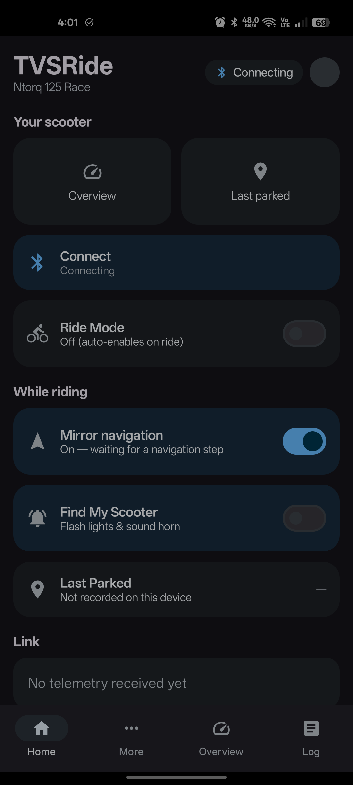
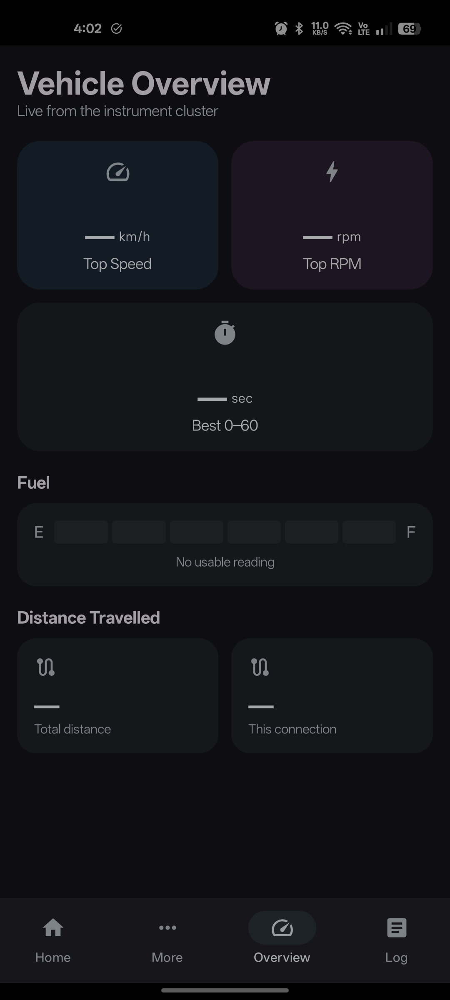
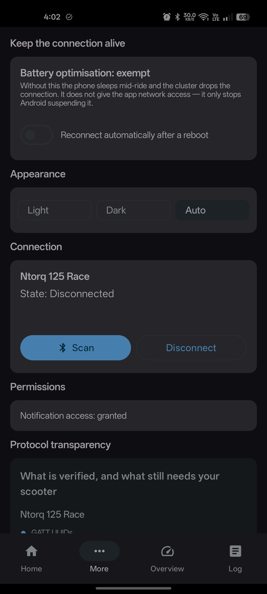
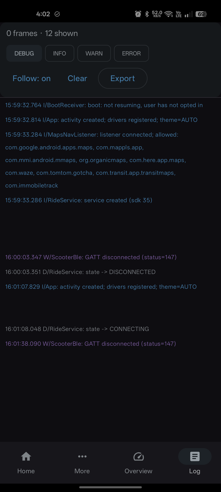

# TVSRide

A third-party companion app for **TVS SmartXonnect** vehicles — Ntorq, Jupiter,
Apache, Raider, iQube. Speaks the instrument cluster's Bluetooth LE protocol
directly and mirrors turn-by-turn navigation from **whatever maps app you
already use**, with **no TVS account and no network access at all**.

```
Google Maps / MapMyIndia / Organic Maps / Waze
        │  (notification, read-only)
        ▼
  NotificationListenerService  ──►  pictogram + text  ──►  BLE  ──►  cluster
```

The manifest has **no `INTERNET` permission**. That is deliberate: "works
without logging in" is enforced by the build, not promised in a README.

---

## Status

| Area | State |
| :--- | :--- |
| Ntorq + Raider inbound | 8 frame layouts, **confirmed against a real cluster** |
| GATT / transport | **working on hardware** — GATT up in ~0.4 s, MTU 65, 20-byte frames |
| Discovery + connect | **connected to the rider's own Ntorq 125**; reconnects after a drop |
| AES-CTR handshake | built, and **the cluster never sends a challenge** — unused on this vehicle |
| Navigation HUD packets | **observed on the wire** — `0x5A 0x4E` and `0x5B 0x4F` reaching the cluster |
| Caller ID / SMS | packets wired; cluster supports it per the manual; **not yet seen live** |
| Text sanitiser | fixed on hardware — punctuation no longer becomes `X` |
| Cluster alpha-numeric rows | **layout still unconfirmed** — see the open questions below |
| UI | adapted Material 3, light/dark/auto, **running on device** |
| Tests | 48 JVM tests over the protocol layer, run in CI |
| APK analysis | complete for the protocol packages |

The handshake, GATT and navigation layouts are cross-checked against **two**
independent applications. Where they agree, a fact is solid; where they differ,
both are documented rather than silently merged.

### Screenshots

Captured from the running app. The cluster is currently out of service with a
flat battery, so these show the **disconnected** state — which is also the state
a new user sees first. No location, no street names, no device identifiers: the
cluster MAC is redacted wherever the UI shows it.

| Home | Overview |
| :--- | :--- |
|  |  |

| More | Frame log |
| :--- | :--- |
|  |  |

Overview is the interesting one when disconnected: every tile reads `—` and the
fuel gauge says **No usable reading**. Neither is a placeholder. A tile showing
`0` with no scooter connected would mean the UI was inventing data.

Home shows **Mirror navigation** already on, with nothing to switch. It is the
app's reason to exist, and the bridge does nothing until a maps app posts a
navigation notification — so enabling it costs nothing and asking twice is a
worse default. The toggle is still there for anyone who wants the cluster left
alone.

The Log tab is the project's evidence base: every frame in and out is hex-dumped
with a timestamp, and **Export** writes a bundle to
`Android/data/dev.tvsopen/files/logs/` that can be pulled without root. In the
shot above the log is 12 lines for a full launch and two connect attempts. An
earlier build logged a dropped write every two seconds for as long as the link
was down, which was 28% of every log file — the same failure hiding in the
evidence as in the display.

### Tested on a phone. Never connected to a scooter.

Those are two very different claims and it is worth keeping them apart.

`:app:assembleDebug` succeeds with zero warnings; CI runs the unit tests and
asserts the merged manifest contains **no `INTERNET` permission**. The app has
been installed and driven on a real device many times — which is how the
Overview/Log tab swap, an unreachable Ride Mode toggle, and a log sink that
discarded every session were all found. None of them were visible to any test.

### Connected, and what that changed

A Bluetooth connection to the owner's own Ntorq 125 happened on 2026-10-13, and
it corrected more assumptions than it confirmed:

- **The cluster advertises no service UUID.** A scan filtered on the documented
  UUID finds nothing. It has to be found by name.
- **No pair mode and no bonding are needed**, and the cluster sends **no `9B F2`
  challenge** — the handshake is implemented and unused on this vehicle.
- **The transcribed frame table is partly wrong.** `0x16` arrives nearly as often
  as the speedometer and is not in it; `0x19` is listed and never arrives.
- **Multi-byte fields were read little-endian** while the cluster sends
  big-endian. The odometer read 278,733 km on a bike ridden 16,593 km.
- **Navigation mirroring had never sent a frame.** The bridge was handed a null
  instruction on every frame, and the UI strip read a different flow, so it
  *looked* end-to-end on the phone while having never once run over BLE.

Every one of those produced a screen that looked right. That is the argument for
reading the raw bytes rather than trusting the display.

Still unconfirmed: the alpha-numeric row layout, whether the cluster renders
`+` and `-`, and caller ID end to end.

---

## Universal by architecture, Ntorq-verified by hardware

The official app splits its protocol one package per model
(`protocol/ntorq`, `protocol/jupiter`, `protocol/apache`, `protocol/raider`,
`protocol/u388`, …). We mirror that:

```
protocol/
  Constants.kt        frame ids, GATT UUIDs, checksum
  VehicleModel.kt     model registry + capability flags
  ProtocolDriver.kt   the per-model interface + generic fallback
  NtorqDriver.kt      Ntorq + Raider: transcribed frame layouts
  PacketBuilder.kt    outbound frames (nav layout proven)
  Handshake.kt        AES-CTR challenge/response
  Pictogram.kt        maneuver table + text-keyword fallback
transport/
  ScooterScanner.kt      BLE discovery, filtered on the SmartXonnect service
  ScooterBleService.kt   GATT, write mutex, frame stream
  RideService.kt         foreground service
  BootReceiver.kt        re-attach after reboot, when the user opts in
nav/
  MapsNotificationListener.kt   any maps app → NavInstruction
  NavigationBridge.kt           NavInstruction → cluster frames
session/  process-scoped store the UI observes; the only shared state
prefs/    ride mode, last known cluster, appearance
log/      logger: ring buffer, rotating file sink, hex frame capture
ui/       Compose screens (Home, Overview, More, Scan, Log) + theme
```

A model with no driver still **connects and streams raw frames** — that is how a
new vehicle gets characterised without writing a driver first.

Adding a model means writing one `ProtocolDriver`. The transport does not change.

---

## What it does

- **Navigation on the cluster** from any maps app, no account
- **Find my scooter** — injects the flag into the keepalive packet
- **Live telemetry** — speed, odometer, fuel, trip, engine temp, service status
- **Find and connect** — BLE scan filtered on the SmartXonnect service
- **No cloud** — nothing leaves the phone

Telemetry is limited to values the Ntorq cluster is documented to display. TVS's
own manual enumerates every display element, and **range and fuel economy are
not among them** — they are app or cloud figures, and this app has neither. So
they are decoded but not shown; see [docs/NAVIGATION.md](docs/NAVIGATION.md).

---

## Build

```bash
./gradlew :app:testDebugUnitTest :app:assembleDebug
```

CPU budget is capped at 2 cores by `gradle.properties`; see
[AGENTS.md](AGENTS.md) for the full rule, and [BUILD.md](docs/BUILD.md) for
prerequisites.

CI (`.github/workflows/android.yml`) runs the unit tests, asserts the merged
manifest has **no** `INTERNET` permission, asserts the caller-ID permissions
stay **absent**, and attaches the APK to a release on a `v*` tag.

---

## Documentation

| File | Contents |
| :--- | :--- |
| [docs/SCOPE.md](docs/SCOPE.md) | what this project is and deliberately is not |
| [docs/PROTOCOL.md](docs/PROTOCOL.md) | the BLE protocol, with per-fact provenance |
| [docs/NAVIGATION.md](docs/NAVIGATION.md) | navigation architecture, pictogram tables, cluster display zones |
| [docs/UI_REFERENCE.md](docs/UI_REFERENCE.md) | which apps the UI draws on, and privacy rules |
| [docs/BUILD.md](docs/BUILD.md) | prerequisites, CPU-capped build command, gotchas |
| [docs/CAPTURE.md](docs/CAPTURE.md) | what still needs a scooter, and how to get it |
| [research/SOURCES.md](research/SOURCES.md) | every source, and what it contributed |
| [AGENTS.md](AGENTS.md) | working rules for agents on this repo |

`ref/` holds UI reference screenshots and is **gitignored** — it contains
personal data (registration number, home location). See
[docs/UI_REFERENCE.md](docs/UI_REFERENCE.md) §3.

---

## Sources

Full attribution, licences and per-source contribution notes are in
[research/SOURCES.md](research/SOURCES.md). Every third-party repository there is
pinned to an exact commit with a clone command, so a reader reproduces precisely
what was read rather than whatever `master` is today.

| Repository | Clone URL | Licence |
| :--- | :--- | :--- |
| [overclock98/JupiterRideCompanion](https://github.com/overclock98/JupiterRideCompanion) | `https://github.com/overclock98/JupiterRideCompanion.git` | CC BY-NC 4.0 |
| [Hyundai-Kia-Connect/kia_uvo.wiki](https://github.com/Hyundai-Kia-Connect/kia_uvo.wiki) | `https://github.com/Hyundai-Kia-Connect/kia_uvo.wiki.git` | CC0 |
| [aaravavi/TVS-Connect-Application-VAPT](https://github.com/aaravavi/TVS-Connect-Application-VAPT) | `https://github.com/aaravavi/TVS-Connect-Application-VAPT.git` | CC0 1.0 |

What each contributed:

- **`overclock98/JupiterRideCompanion`** — the only working third-party app
  available. Source of the proven navigation packet layout, an independent crypto
  cross-check, and the Home-screen layout this app adapts.
- **`aaravavi/TVS-Connect-Application-VAPT`** — FEV LTD's pentest. Its crypto
  finding (CVE-2024-35537) is what demonstrated the BLE "auth" key is hardcoded.
  Background only; the server-side CVEs are unused by design, see SCOPE.
- **`Hyundai-Kia-Connect/kia_uvo.wiki`** — an unrelated vehicle, but its
  methodology (intercept, observe, reimplement) is the transferable part.

**Local artifacts** (parent folder, not redistributed here)

- `TVS Connect_8.14.1.apk` — the official app, primary protocol source, cited
  by SHA-256
- `JupiterRideCompanion/JupiterRideCompanion.apk` — that project's own build
- TechEnclave thread + `research/refs.txt` — supplied reference list
- `ref/` — TVS's Ntorq 125 owner manual, gitignored for containing personal data

**Web** — TVS product docs, Google Play listing, r/indianbikes,
1013503897/jadx-headless-mcp, morluto/rea.

---

## Licence

Non-commercial. See [LICENSE](LICENSE).

The protocol documentation in `docs/` reuses prose and the maneuver byte table
from `overclock98/JupiterRideCompanion` (CC BY-NC 4.0) under attribution, on
the same non-commercial terms.